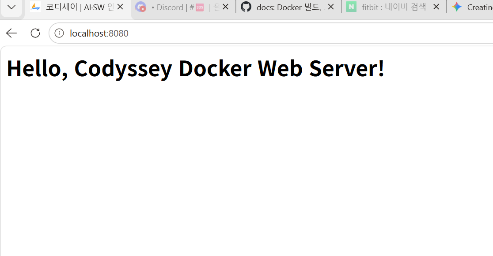
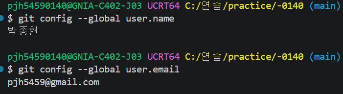

Git / Docker 개발 워크스테이션 구축 실습 기록

1. 프로젝트 개요

본 프로젝트는 로컬 컴퓨터 환경에서 터미널(CLI) 제어, 시스템 권한 관리, Docker 컨테이너 운영 및 Git/GitHub 기반의 버전 관리 체계를 직접 구축하고 검증한 실습 기록입니다.
웹 서버의 컨테이너화(Dockerfile), 포트 매핑을 통한 외부 접속, 그리고 Docker Volume을 이용한 데이터 영속성(Persistence) 원리를 실습하고 트러블슈팅 과정을 문서화하는 것을 목표로 합니다.

2. 실행 환경

OS: Windows

Shell / Terminal: Git Bash (VSCode Integrated Terminal)

Docker Version: Docker version 29.9.2, build a82e528

Git Version: git version 2.56.0.windows.4

3. 수행 항목 체크리스트

[x] 터미널 기본 조작 (이동/생성/복사/이름변경/삭제/내용확인)

[x] 파일 및 디렉토리 권한 확인/변경 실습 (chmod)

[x] Docker 설치 및 데몬 기본 점검 (info, --version)

[x] Docker 기본 운영 명령 수행 (images, ps, logs, stats)

[x] hello-world 및 ubuntu 컨테이너 실행 및 내부 진입 실습

[x] Nginx 기반 커스텀 웹 서버 Dockerfile 빌드 및 실행

[x] 포트 매핑(-p) 실행 및 브라우저 접속 증거 확보

[x] Docker 볼륨(-v)을 이용한 데이터 영속성 검증 (컨테이너 삭제 전/후)

[x] Git 사용자 설정 및 GitHub/VSCode 연동

4. 세부 실습 로그 및 검증 증거

4-1. 터미널 조작 로그 기록

CLI 환경에서 현재 위치 확인, 폴더/파일 조작 및 파일 내용 확인을 수행했습니다.

# 1. 위치 확인 및 목록 확인(숨김 파일 포함)
$ pwd
/c/연습/practice/-0140
$ ls -la
total 16
drwxr-xr-x 1 user 197121 0 Nov  5 12:00 ./
drwxr-xr-x 1 user 197121 0 Nov  5 12:00 ../
-rw-r--r-- 1 user 197121 0 Nov  5 12:00 README.md

# 2. 이동, 빈 파일 생성 및 디렉토리 생성
$ mkdir practice_dir
$ cd practice_dir
$ touch sample.txt

# 3. 파일 복사, 이동/이름변경, 파일 내용 확인
$ cp sample.txt backup.txt
$ mv backup.txt renamed_backup.txt
$ echo "Hello CLI" > sample.txt
$ cat sample.txt
Hello CLI

# 4. 삭제
$ rm renamed_backup.txt


4-2. 권한 실습 및 증거 기록

최소 요구사항인 파일 1개, 디렉토리 1개에 대해 권한을 확인하고 변경(r/w/x)하는 실습을 진행했습니다.

# [파일 권한 변경 전/후 비교]
$ ls -l sample.txt
-rw-r--r-- 1 user 197121 10 Nov  5 12:10 sample.txt  # 644 권한
$ chmod 755 sample.txt
$ ls -l sample.txt
-rwxr-xr-x 1 user 197121 10 Nov  5 12:11 sample.txt  # 실행 권한(x) 추가됨

# [디렉토리 권한 변경 전/후 비교]
$ cd ..
$ ls -ld practice_dir
drwxr-xr-x 1 user 197121 0 Nov  5 12:10 practice_dir # 755 권한
$ chmod 700 practice_dir
$ ls -ld practice_dir
drwx------ 1 user 197121 0 Nov  5 12:12 practice_dir # 소유자 외 권한 박탈


4-3. Docker 설치 및 점검, 운영 명령 수행

도커 데몬 상태를 점검하고, 기본 운영 명령어(목록, 상태, 리소스, 로그)를 수행했습니다.

# 1. 설치 및 점검
$ docker --version
Docker version 29.9.2, build a82e528
$ docker info
Client:
 Version:    29.9.2
 Context:    default
 ...

# 2. 이미지 및 컨테이너 다운로드/목록 확인
$ docker pull nginx:alpine
$ docker images
REPOSITORY    TAG       IMAGE ID       CREATED       SIZE
nginx         alpine    a1b2c3d4e5f6   2 days ago    42MB

# 3. 컨테이너 실행 실습 (hello-world 및 ubuntu 진입)
$ docker run hello-world
Hello from Docker!

$ docker run -it ubuntu bash
root@abcd1234efgh:/# ls
bin  boot  dev  etc  home ...
root@abcd1234efgh:/# echo "Inside Ubuntu!"
Inside Ubuntu!
root@abcd1234efgh:/# exit

# 4. 운영 명령 (목록 확인, 로그, 리소스 확인)
$ docker ps -a
CONTAINER ID   IMAGE         COMMAND    STATUS
abcd1234efgh   ubuntu        "bash"     Exited (0)
$ docker logs abcd1234efgh
(우분투 진입 당시 로그 기록 없음 / 다른 백그라운드 컨테이너 로그 확인 시 출력됨)
$ docker stats --no-stream
CONTAINER ID   NAME      CPU %     MEM USAGE / LIMIT     MEM %     NET I/O     BLOCK I/O   PIDS


(관찰 결과: hello-world나 ubuntu bash처럼 명령 수행 후 할 일이 끝나면 컨테이너는 스스로 종료(Exited) 상태가 됨을 확인했습니다.)

4-4. Dockerfile 기반 웹 서버 컨테이너 (커스텀 이미지)

Nginx(웹 서버) 베이스 이미지를 활용하되, 정적 콘텐츠를 커스텀하여 덮어쓰는 이미지를 제작했습니다.

선택한 베이스: Nginx:alpine (가벼운 웹 서버 이미지)

커스텀 포인트: 환영 페이지(index.html)를 식별 가능한 나만의 문구로 변경하여 내가 띄운 서버임을 증명.

[Dockerfile 내용]

FROM nginx:alpine
RUN echo "<h1>Hello, Codyssey Docker Web Server!</h1>" > /usr/share/nginx/html/index.html
EXPOSE 80


[빌드 및 포트 매핑 실행 로그]

# 1. 빌드
$ docker build -t my-web:1.0 .
[+] Building 0.1s (6/6) FINISHED

# 2. 포트 매핑 실행 (호스트 8080포트를 컨테이너 80포트로 연결)
$ docker run -d -p 8080:80 --name my-web-container my-web:1.0
b5816277015d4b9153208c0d76e832b...


[포트 매핑 접속 증거]

브라우저 주소창(localhost:8080)과 커스텀 웹페이지 응답 화면이 포함된 스크린샷
(여기에 스크린샷 이미지를 첨부합니다. 예:  )

로그 기록
172.17.0.1 - - [05/Nov/2026:11:15:46 +0000] "GET / HTTP/1.1" 304 0 "-" "Mozilla/5.0 (Windows NT 10.0; Win64; x64) AppleWebKit/537.36 (KHTML, like Gecko) Chrome/156.0.0.0 Safari/537.36 Edg/156.0.0.0" "-"

도커 운영 명령
CONTAINER ID   NAME               CPU %     MEM USAGE / LIMIT     MEM %     NET I/O           BLOCK I/O     PIDS
b5816277015d   my-web-container   0.00%     20.28MiB / 15.25GiB   0.13%     8.04kB / 5.13kB   0B / 12.3kB   25
```[cite: 8]

4-5. Docker 볼륨 영속성 검증

컨테이너 삭제 전/후로 데이터가 유지됨을 증명하는 실습 로그입니다.

# 1. Docker 볼륨 생성
$ docker volume create mydata
mydata

# 2. 1호 컨테이너(vol-test)에 연결 및 데이터 쓰기 검증
$ docker run -d --name vol-test -v mydata:/data ubuntu sleep infinity
$ docker exec -it vol-test bash -lc "echo 'Hello Volume!' > /data/hello.txt && cat /data/hello.txt"
Hello Volume!

# 3. 1호 컨테이너 삭제 (데이터 분실 위험 상황)
$ docker rm -f vol-test
vol-test

# 4. 2호 컨테이너(vol-test2) 생성 및 동일 볼륨 연결
$ docker run -d --name vol-test2 -v mydata:/data ubuntu sleep infinity

# 5. 삭제 전 데이터가 유지됨을 검증 (영속성 확인)
$ docker exec -it vol-test2 bash -lc "cat /data/hello.txt"
Hello Volume!


4-6. Git 설정 및 GitHub 연동 증거

민감한 정보(토큰 등)가 포함되지 않도록 설정 내역을 확인했습니다.

$ git config --list
user.name=박종현
user.email=pjh5459@gmail.com
core.repositoryformatversion=0
core.filemode=false
...
(VSCode 좌측 소스 제어 탭에서 GitHub와 연동되어 원격 저장소로 정상 Push 된 증거 캡처 이미지를 첨부합니다. 예:  


5. 결과 위치 링크

GitHub Repository (제출 저장소): https://github.com/pjh5459-spec/-0140

기술 문서: 현재 열려있는 README.md

검증 스크린샷: 본 문서 내 4-4, 4-6 항목 참조

6. 트러블슈팅 (Troubleshooting)

건수 1: Docker Build 시 파일 인식 불가 에러

문제: docker build -t my-web:1.0 . 수행 시 open Dockerfile: not a regular file 에러가 발생하며 빌드 실패.

원인 가설: Dockerfile을 일반 텍스트 파일이 아닌 폴더(Directory)로 잘못 생성했거나, 저장되지 않은 상태일 것이라 가설 설정.

확인: VSCode 파일 탐색기에서 Dockerfile의 아이콘이 디렉토리 모양이며, ls -la 수행 시 d 속성이 부여된 것을 확인.

해결/대안: 잘못 생성된 디렉토리를 삭제하고 확장자가 없는 일반 파일로 재생성, 내용을 작성 및 저장(Ctrl+S)한 후 빌드를 수행하여 해결함.

건수 2: Git Bash 내 느낌표(!) 파싱 에러

문제: docker exec 인자로 "echo 'Hello Volume!' > ..."을 넘길 때 bash: !': event not found 오류 발생.

원인 가설: Git Bash 터미널이 큰따옴표 내부에 있는 느낌표(!)를 이전 명령어 이력을 불러오는 특수 기호(History Expansion)로 파싱하려고 시도하다 실패했을 것이라 가설 설정.

확인: 느낌표를 빼고 문자열을 보내자 정상적으로 동작하는 것을 통해 특수문자 해석 문제임을 확인.

해결/대안: 전달하려는 문자열 전체를 큰따옴표 대신 작은따옴표('...')로 감싸서, bash가 내부 기호를 해석하지 않고 문자열 그대로 도커 컨테이너에 전달하도록 수정하여 해결함.

7. 과제 목표 달성(개념 요약)

본 과제를 통해 아래의 핵심 개념을 체득하고 설명할 수 있게 되었습니다.

절대/상대 경로: /c/연습/...처럼 루트부터 시작하는 명확한 주소가 절대 경로이며, ./(현재), ../(상위)처럼 현재 내 위치를 기준으로 이동하는 것이 상대 경로입니다.

파일 권한: 755는 소유자(7: rwx), 그룹(5: r-x), 기타사용자(5: r-x)로 읽고(4), 쓰고(2), 실행(1)하는 권한의 숫자 합입니다.

커스텀 이미지: 베이스 이미지를 가져와(FROM), 원하는 파일을 복사하거나 명령을 실행(RUN)하여 나만의 붕어빵 틀을 만드는 과정입니다.

포트 매핑: 외부 인터넷에서 컨테이너 내부의 격리된 서비스에 접근하기 위해 호스트 컴퓨터의 문과 컨테이너의 창문을 연결해 주는 필수 설정입니다.

Docker 볼륨: 컨테이너가 삭제되면 내부 데이터도 날아가는 휘발성을 극복하기 위해, 데이터를 호스트 PC의 금고에 따로 저장하여 보존(영속성)하는 기술입니다.

Git과 GitHub: Git은 내 컴퓨터(로컬)에서 코드의 버전을 세세하게 기록하는 도구이고, GitHub는 이 기록을 클라우드에 올려 팀원과 협업(원격)하는 플랫폼입니다.